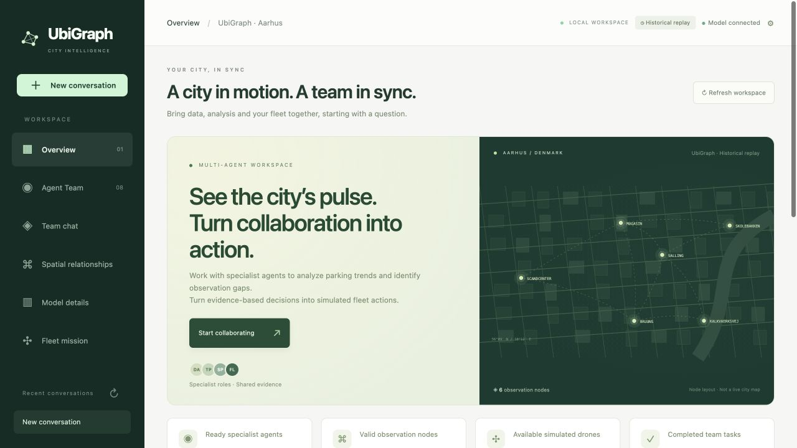

# UbiGraph

A local workspace for conversational urban analysis and reviewed sensing missions. Ask a question, inspect a model forecast, review structured flight commands, and follow a three-drone simulation.

[](docs/media/ubigraph-demo.mp4)

**[Watch the 38-second demo video](docs/media/ubigraph-demo.mp4)** · [Forecast and agent collaboration](docs/media/forecast.jpg) · [Mission planning and execution](docs/media/fleet.jpg)

The demo includes historical data and pretrained models. No training, frontend build, Node.js installation or drone hardware is needed. Chat uses your LLM provider; numerical predictions run locally.

## Quick start

### 1. Download and install

Choose **Code → Download ZIP** on GitHub and extract it, or clone:

```bash
git clone https://github.com/re-plicate/Ubigraph-Demo.git
cd Ubigraph-Demo
```

Use **Python 3.12** and a browser. Python 3.10–3.12 are supported; newer Python versions may not work with these numerical dependencies. The release was tested on macOS with Python 3.12; the Linux and Windows commands are provided but have not been verified on those systems.

**macOS / Linux**

```bash
python3.12 -m venv .venv
.venv/bin/python -m pip install --upgrade pip
.venv/bin/python -m pip install -e .
```

**Windows PowerShell**

```powershell
py -3.12 -m venv .venv
.\.venv\Scripts\python.exe -m pip install --upgrade pip
.\.venv\Scripts\python.exe -m pip install -e .
```

On Intel macOS, if PyTorch dependency resolution fails, install the verified combination, then repeat `pip install -e .`:

```bash
.venv/bin/python -m pip install 'torch==2.2.2' 'numpy==1.26.4' 'scipy==1.14.1'
```

### 2. Configure chat

Copy `.env.example` to **`.env.local`** in the repository root. Preserve an existing `.env.local` if you already have one.

```bash
# First setup only, macOS / Linux
cp .env.example .env.local
```

On Windows use `Copy-Item .env.example .env.local`. Open the new file in your editor:

```dotenv
OPENAI_API_KEY=YOUR_DEEPSEEK_API_KEY
OPENAI_BASE_URL=https://api.deepseek.com
OPENAI_MODEL=deepseek-flash
UBIGRAPH_API_STYLE=auto
```

The application uses `OPENAI_*` variable names for compatible providers too. The key needs API credit and access to the selected model. The model name must be available from your provider. DeepSeek setup is documented in its [official API guide](https://api-docs.deepseek.com/).

`auto` selects **Chat Completions** for DeepSeek and **Responses** for other endpoints. For another compatible provider, set `UBIGRAPH_API_STYLE=chat_completions` or `responses` explicitly. Streaming and function calling must be supported. For OpenAI, use `https://api.openai.com/v1` and a model available to your account.

Credentials remain on the backend. The browser does not receive your key. Local credential files are ignored by Git. Shell environment variables override the file; restart UbiGraph after a configuration change.

**Without a key**, the overview, spatial graph, model details and manual fleet planning/execution remain usable. Conversational requests require a configured provider.

### 3. Launch

**macOS / Linux**

```bash
bash run_agent.sh
```

On macOS you can also double-click **Start Demo.command** after installation. If needed, run `chmod +x run_agent.sh 'Start Demo.command'` first.

**Windows PowerShell**

```powershell
.\.venv\Scripts\python.exe -m ubigraph_agent --open-browser
```

Open **http://127.0.0.1:8765**. Keep the terminal open; press **Ctrl+C** there to stop the server. The launcher reuses an already healthy local instance. Initial model loading may take tens of seconds.

To select a Python environment or use another port:

```bash
UBIGRAPH_PYTHON="$PWD/.venv/bin/python" bash run_agent.sh --port 8875
# Start without opening a browser:
bash run_agent.sh --no-browser
```

The launcher prefers `UBIGRAPH_PYTHON`, then `.venv-macos`, then `.venv`. Do not copy virtual environments between computers.

## Try the demo

### Forecast and inspect evidence

Open **Team chat**. Keep cutoff **2014-09-30T23:30**, **Full history**, and seed **7**:

> Forecast BRUUNS parking availability for the next 30 minutes and find the two most similar garages. Keep the answer brief and use the tools.

The timeline shows actual forecasting and spatial tool calls. The included checkpoint predicts approximately **902.95 available spaces** for **2014-10-01 00:00**. Its nearest CoSimHeat neighbors are KALKVAERKSVEJ and SALLING. Select a specialist in **Delegate to**, or keep automatic orchestration.


### Inspect missing observations

Set **Data cutoff** to **2014-10-01T16:00**. A context change starts a new conversation:

> Inspect observation quality at all six garages. Explain which locations need fresh observations. Recommend collection targets only; do not execute.

Collection recommendations use observed/missing inputs and freshness. Spatial similarity and attention weights are not calibrated confidence scores.

### Review commands and run a mission

Keep **Simulation execution → Review commands first**:

> Check fleet status and plan simulated collection at G1, G3 and G5. Use available drones, collect for 3 seconds per target, return and land. Generate commands for review only; do not execute.

Open **Fleet mission**. Inspect the **Command workspace**, download its JSON if useful, then click **Execute simulation commands**. Alternatively, select targets under **External mission input**, click **Generate plan**, then **Execute plan**. Manual planning works without a model key.


The fleet runs independently of chat. **Cancel remaining visits & return** requests a return; stopping an assistant response does not stop a mission. Speed controls change simulation speed. Collection duration rounds up to the simulator's 2-second slots. The planner may use fewer than all three drones.

## What runs

| Component | Behavior |
|---|---|
| Orchestrator | One configured LLM selects typed tools in a bounded loop. |
| Data inspection | Reads causal historical windows, gaps, masks and observation age. |
| Temporal forecasting | Runs the included frozen V3 model locally. |
| Spatial analysis | Displays the model's CoSimHeat geographic prior and computed attention. |
| Decision review | Recommends collection from observation quality. |
| Fleet dispatch | Validates plans, produces commands and runs a three-drone motion simulator. |
| Vision detection | Optional vehicle detector; requires local COCO weights and an image. |
| Transfer | Optional nearest-profile borrowing baseline, marked experimental. |

The specialists are registered Python handlers, rather than separate LLM instances. SQLite stores conversations, tool events, plans and execution receipts under `runtime/agent/`. Records persist after restart; incomplete jobs are marked interrupted.

**Data mode:** historical Aarhus replay, not live parking availability. The serving model covers six garages and forecasts one 30-minute step from 24 half-hour observations. The raw data has irregular timestamps; alignment is preprocessing.

**Execution mode:** motion simulation with no connected drone hardware. Command manifests use `ubigraph.flight.v1`. Collection produces action receipts with `measurement=null`; it does not create parking measurements, update the dataset or retrain the model.

For optional vehicle detection:

```bash
.venv/bin/python -m pip install -e '.[vision]'
```

Set `UBIGRAPH_DETECTION_WEIGHTS=/absolute/path/to/coco-weights.pt` in `.env.local`, then restart. Without weights the agent reports **unconfigured**; simulated collection does not supply an image.

## Repository contents

This repository distributes the runnable demo. Experiment runners, comparison results, training datasets prepared for experiments, ablation checkpoints and paper sources are excluded.

| Path | Purpose |
|---|---|
| `ubigraph_agent/` | Local HTTP/SSE service, chat runtime, tools and browser interface. |
| `ubigraph_agents/` | Specialist handlers and agent bus. |
| `ubigraph_core/`, `ubigraph_st/` | Numerical components needed to load and serve the trained model. |
| `ubigraph_drone/` | Assignment, routing, simulator, commands and receipts. |
| `data/raw/` | Aarhus observations and garage metadata. |
| `models/parking/` | Serving configuration, geographic prior and pretrained full-history checkpoints. |
| `tests/` | Demo regression checks. |
| `docs/media/` | Screenshots and walkthrough video. |

Keep `data/raw/` and the checkpoint files referenced by `models/parking/serving.json` when downloading. An API key cannot replace those assets.

## Data attribution

The historical Aarhus parking dataset originates from the EU FP7 urban sensing project identified in the [EU-hosted D2.3 report](https://cordis.europa.eu/docs/projects/cnect/5/609035/080/deliverables/001-D23Ares2015916740.pdf). That report describes the May–November 2014 parking records and CC BY 4.0 attribution requirements. The [archived dataset catalog](https://smartcity.linkeddata.es/datasets/datasets/iot.ee.surrey.ac.uk8080datasets.htmlparking.html) describes eight lots and 55,264 observations. The original CSV has those characteristics; the serving model uses six garages. An original download receipt and independently verified upstream checksum are not available in this release.

The video and screenshots demonstrate historical replay and simulated missions; they are not footage of live urban sensing or physical flights.

## Troubleshooting

| Issue | What to check |
|---|---|
| Python or dependency installation fails | Use Python 3.12 and a fresh virtual environment; see the Intel macOS versions above. |
| Missing CSV or checkpoint | Download the complete repository, including `data/raw/` and `models/parking/`. |
| Port or runtime directory in use | Open the existing service, or stop its terminal before starting another instance. |
| Browser does not open | Open the local address printed by the launcher. |
| Chat is not configured | Check the root `.env.local`, shell overrides and restart. |
| API authentication or balance error | Check the key, provider account, credit, model name and API style. |
| Tools fail after model selection | Check support for streaming and function calling; a model catalog response alone does not verify chat. |
| Historical input invalid | Use a supported half-hour cutoff and inspect observation quality. |
| Plan stale or infeasible | Check battery, faults and targets, then generate a new plan. |
| Fleet continues after stopping chat | Use the fleet cancellation control. |

## Regression checks

```bash
.venv/bin/python -m pip install -e '.[test]'
.venv/bin/python -m pytest
```

These checks use local numerical models, simulator behavior and controlled provider streams; they do not require a paid API key. A separate live DeepSeek check also verified forecasting, spatial tool continuation and reviewed mission planning.
