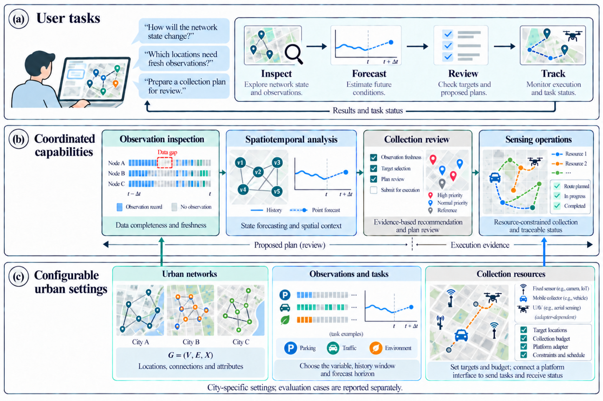
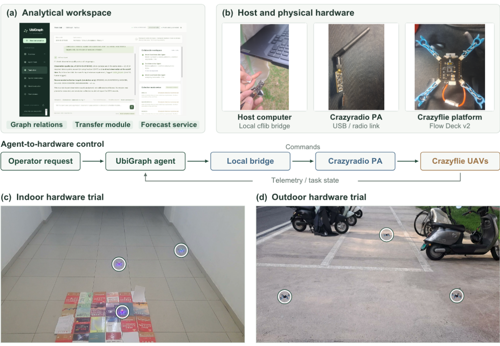
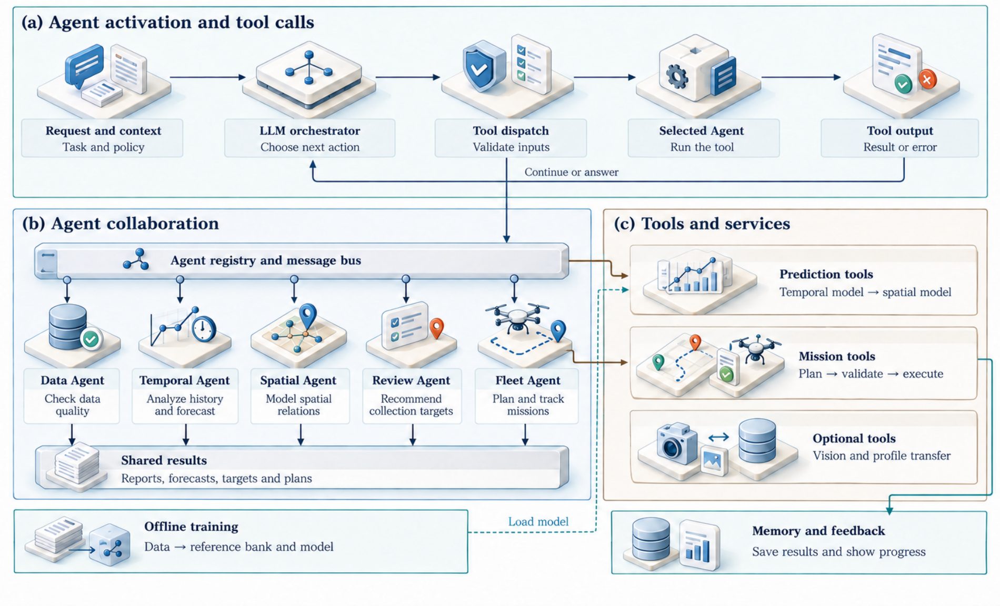
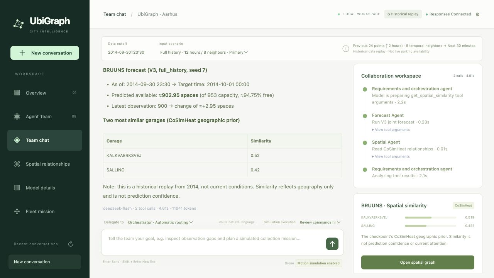
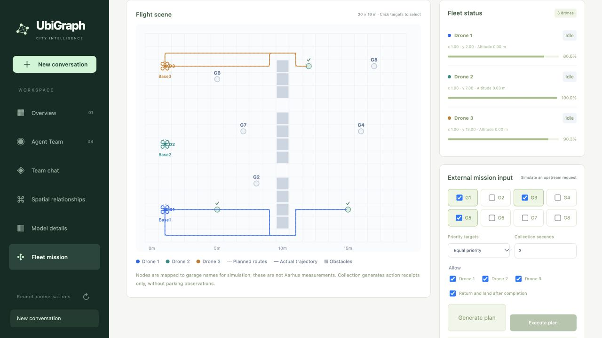
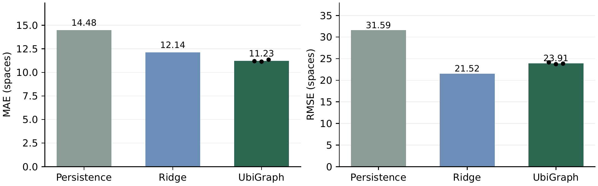

# UbiGraph

**Connecting Observation Quality, Graph-Condensed Forecasting, and Reviewable Urban Sensing.**

UbiGraph connects natural-language requests to observation inspection, local spatiotemporal forecasting, and reviewed collection missions. One LLM orchestrates specialist tools; numerical services compute forecasts and mission services record execution.

[Demo](#demo) | [Agent architecture](#agent-architecture) | [Research snapshot](#research-snapshot) | [Quick start](#quick-start) | [Documentation](docs/USAGE.md)



**From observations to reviewed actions.** Inspect input quality, forecast future conditions, review proposed targets, and track execution. City networks, analytical tasks, and collection resources are configurable framework inputs; the packaged demo uses Aarhus parking replay and a three-drone simulator. Maps and routes in this figure are schematic.

Three ideas connect the research and the system:

- **Observation context.** Preserve missingness, data age, and the prediction cutoff when inspecting observations and recommending collection.
- **Compact forecasting.** Condense historical windows offline while preserving observation masks and data age. Reference messages use outcomes available at the prediction cutoff; runtime loads frozen checkpoints.
- **Reviewable coordination.** Use typed tools and explicit execution policy while keeping observations, computed forecasts, proposed plans, and action receipts distinct.

## Demo

https://github.com/user-attachments/assets/7e519ba6-0425-4a57-898c-e75e8f9925a8

**Agent-to-drone control, from conversation to execution feedback (2:49).** A real control session showing task input, plan generation, tool calls, physical flight, and the final backend report. English female narration and subtitles; waiting periods are accelerated and physical footage plays at its original speed.

[Download 1080p video](docs/media/ubigraph-agent-to-flight-1080p.mp4) | [Subtitles](docs/media/ubigraph-agent-to-flight.srt)

The recording uses a Crazyflie hardware bridge. This repository packages the urban-analysis workspace and three-drone simulation described below.

<details>
<summary>Physical prototype and hardware interface</summary>



The manuscript figure shows the analytical workspace, host computer, local cflib bridge, Crazyradio PA, and Crazyflie platforms, with frames from indoor and outdoor hardware trials. It illustrates the hardware pathway; the packaged public demo runs the simulator.

</details>

<details>
<summary>Urban-analysis and simulation walkthrough (2:05)</summary>

https://github.com/user-attachments/assets/713098c2-af6b-46cf-860e-aaaa38d2a6d0

Recorded on an earlier build. [Download the walkthrough](docs/media/ubigraph-full-walkthrough.mp4).

</details>

## Agent architecture



**Activate, call, return, and continue.** The LLM chooses a registered tool; dispatch validates its inputs; the selected service returns a result or an explicit error to the orchestration loop. Core roles share an Agent Bus and reusable artifacts. Offline training prepares the historical bank and model, while runtime services handle prediction, mission execution, and persistent evidence.

The illustrated agents denote software responsibilities coordinated by one configured LLM. Vision and profile transfer remain optional capabilities.

| Implementation entry point | Responsibility |
| --- | --- |
| [Agent runtime](ubigraph_agent/runtime.py) and [shared hub](ubigraph_agent/hub.py) | Bounded tool calls, specialist dispatch, and streaming progress. |
| [Forecast engine](ubigraph_agent/engine.py) and [included models](models/parking) | Historical context, local numerical predictions, and model evidence. |
| [Mission planner](ubigraph_drone/planner.py) and [evidence store](ubigraph_agent/memory.py) | Fleet route planning, conversation context, and persistent tool and mission records. |

<details>
<summary>Workspace screenshots: forecasting and fleet execution</summary>

<table>
<tr>
<td width="50%"></td>
<td width="50%"></td>
</tr>
<tr>
<td><b>Inspect and forecast.</b> See model outputs, spatial context and specialist tool calls in one conversation.</td>
<td><b>Review and track.</b> Inspect planned routes and follow fleet execution, return and landing.</td>
</tr>
</table>

</details>

## Research snapshot



**Primary parking forecast.** The forecaster uses a bank of **96 synchronized historical episodes** and is evaluated on **9,748 common garage-time labels** from six Aarhus garages. UbiGraph reports **MAE 11.229 ± 0.108 spaces**, a **22.4% reduction relative to persistence**. Ridge regression has lower RMSE, so average error and large-error behavior lead to different comparisons. The dots represent three seed fits on the same test cohort.

The original plot and its data are preserved. [Exact metrics, protocol, and figure sources](docs/media/paper/README.md#forecasting-protocol) document this comparison. This repository focuses on the runnable interactive demo; the manuscript's broader training and transfer studies are separate.

## Quick start

Requires **Python 3.12** and a browser. Historical data, spatial priors, and pretrained checkpoints are included.

```bash
git clone https://github.com/re-plicate/Ubigraph-Demo.git
cd Ubigraph-Demo
python3.12 -m venv .venv
.venv/bin/python -m pip install -e .
cp -n .env.example .env.local
```

Set your provider credentials in `.env.local`:

```dotenv
OPENAI_API_KEY=YOUR_API_KEY
OPENAI_BASE_URL=https://api.deepseek.com
OPENAI_MODEL=deepseek-flash
UBIGRAPH_API_STYLE=auto
```

Use a model available to your account with streaming and tool calling. Chat requires API credit; spatial inspection and manual fleet operations work without a key.

```bash
bash run_agent.sh
```

Open **http://127.0.0.1:8765**. Press **Ctrl+C** in the serving terminal to stop. See the [usage guide](docs/USAGE.md#quick-start) for Windows, other providers, and troubleshooting.

## Try a complete task

1. In **Team chat**, keep the default historical cutoff and ask:

   > Forecast BRUUNS parking availability for the next 30 minutes and find the two most similar garages.

2. Select **Review commands first**, then ask:

   > Plan simulated collection at G1, G3 and G5. Return and land after collection. Generate commands for review only.

3. Open **Fleet mission**, review the command manifest, and choose **Execute simulation commands**. Follow the mission state and inspect its action receipts.

## Demo scope

The included instance replays **2014 Aarhus parking data for six garages**, produces **30-minute single-step forecasts**, and runs a **three-drone motion simulator**. Forecasts come from frozen checkpoints; conversations do not retrain the model. Simulated collection records actions with `measurement=null` and does not add measured parking observations.

The hardware recording reports command completion and verified landing. Target arrival was not verified; no parking measurements were collected. Vision requires local detection weights; the transfer module is experimental.

[Configuration and workflows](docs/USAGE.md) | [Data sources](docs/USAGE.md#data-attribution) | [Regression checks](docs/USAGE.md#regression-checks)

[Paper figure sources and captions](docs/media/paper/README.md)
