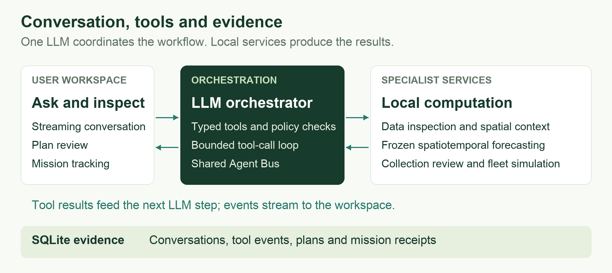

# UbiGraph

**Language-guided urban analytics and reviewed sensing missions.**

UbiGraph turns natural-language requests into data inspection, spatiotemporal forecasts, and reviewable collection plans. One LLM orchestrator coordinates specialist agents through typed tools; local services compute numerical results and track mission execution.

[Quick start](#quick-start) | [Usage guide](docs/USAGE.md) | [Data attribution](docs/USAGE.md#data-attribution)

## See the workflow

https://github.com/user-attachments/assets/7e519ba6-0425-4a57-898c-e75e8f9925a8

**Agent-to-drone control, from conversation to execution feedback (2:49).** A real control session showing task input, plan generation, tool calls, physical flight, and the final backend report. English female narration and subtitles; waiting periods are accelerated and physical footage plays at its original speed.

[Download 1080p video](docs/media/ubigraph-agent-to-flight-1080p.mp4) | [Subtitles](docs/media/ubigraph-agent-to-flight.srt)

The recording uses a Crazyflie hardware bridge. This repository packages the urban-analysis workspace and three-drone simulation described below.

<details>
<summary>Urban-analysis and simulation walkthrough (2:05)</summary>

https://github.com/user-attachments/assets/713098c2-af6b-46cf-860e-aaaa38d2a6d0

Recorded on an earlier build. [Download the walkthrough](docs/media/ubigraph-full-walkthrough.mp4).

</details>

## How it works



- **Tool-grounded analysis.** Data and spatial agents inspect historical observations and relationships. The temporal agent runs a pretrained local model; the LLM explains returned evidence.
- **Review before execution.** Collection recommendations become structured plans and command manifests. The server checks execution policy and plan feasibility before dispatch.
- **Traceable operation.** The browser streams tool progress and mission status. SQLite preserves conversation context, tool results, plan identifiers, and action receipts.

Specialist agents share an in-process bus and operate as executable service roles coordinated by the configured LLM.

## Explore the workspace

<table>
<tr>
<td width="50%"></td>
<td width="50%"></td>
</tr>
<tr>
<td><b>Inspect and forecast.</b> See model outputs, spatial context and specialist tool calls in one conversation.</td>
<td><b>Review and track.</b> Inspect planned routes and follow fleet execution, return and landing.</td>
</tr>
</table>

## Quick start

Requires **Python 3.12** and a browser. Historical data, spatial priors, and pretrained checkpoints are included.

```bash
git clone https://github.com/re-plicate/Ubigraph-Demo.git
cd Ubigraph-Demo
python3.12 -m venv .venv
.venv/bin/python -m pip install -e .
cp -n .env.example .env.local
```

Set your provider credentials in `.env.local`:

```dotenv
OPENAI_API_KEY=YOUR_API_KEY
OPENAI_BASE_URL=https://api.deepseek.com
OPENAI_MODEL=deepseek-flash
UBIGRAPH_API_STYLE=auto
```

Use a model available to your account with streaming and tool calling. Chat requires API credit; spatial inspection and manual fleet operations work without a key.

```bash
bash run_agent.sh
```

Open **http://127.0.0.1:8765**. Press **Ctrl+C** in the serving terminal to stop. See the [usage guide](docs/USAGE.md#quick-start) for Windows, other providers, and troubleshooting.

## Try a complete task

1. In **Team chat**, keep the default historical cutoff and ask:

   > Forecast BRUUNS parking availability for the next 30 minutes and find the two most similar garages.

2. Select **Review commands first**, then ask:

   > Plan simulated collection at G1, G3 and G5. Return and land after collection. Generate commands for review only.

3. Open **Fleet mission**, review the command manifest, and choose **Execute simulation commands**. Follow the mission state and inspect its action receipts.

## Demo scope

The included instance replays **2014 Aarhus parking data for six garages**, produces **30-minute single-step forecasts**, and runs a **three-drone motion simulator**. Forecasts come from frozen checkpoints; conversations do not retrain the model. Simulated collection records actions with `measurement=null` and does not add measured parking observations.

The hardware recording reports command completion and verified landing. Target arrival was not verified; no parking measurements were collected. Vision requires local detection weights; the transfer module is experimental.

[Configuration and workflows](docs/USAGE.md) | [Data sources](docs/USAGE.md#data-attribution) | [Regression checks](docs/USAGE.md#regression-checks)
